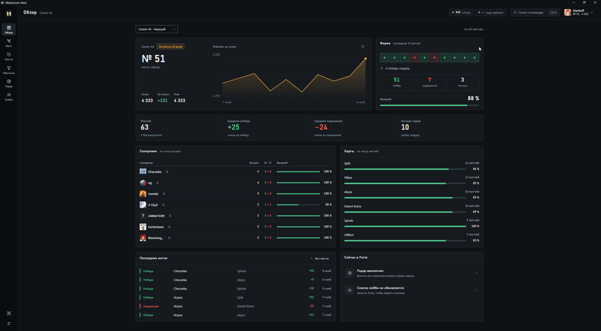
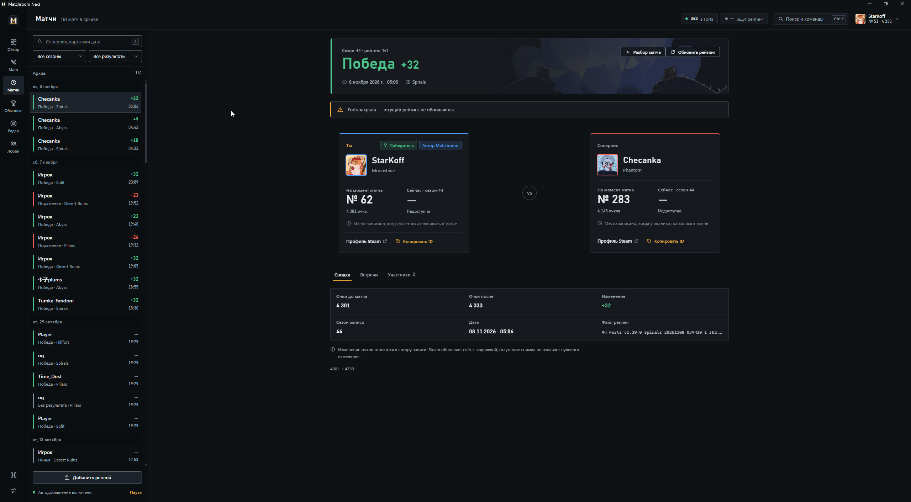
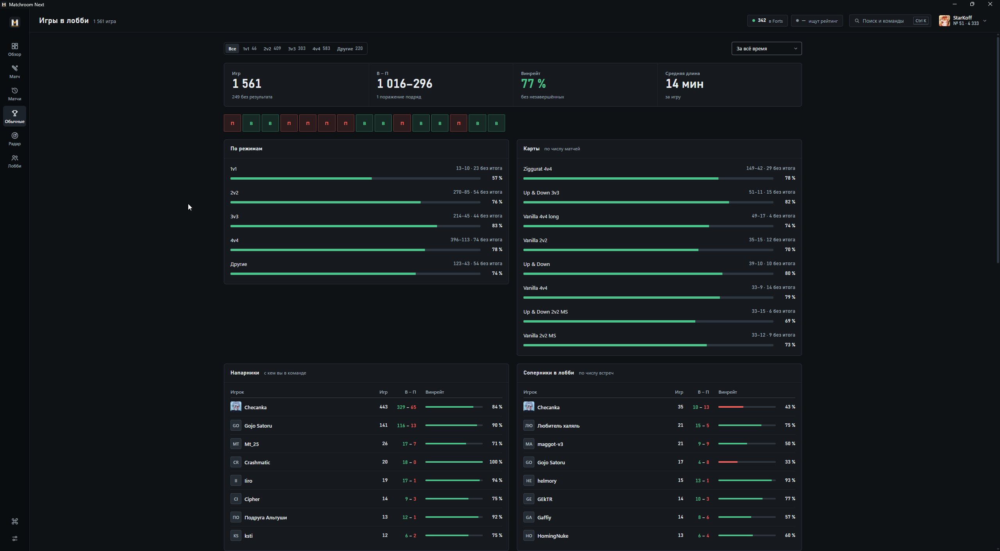
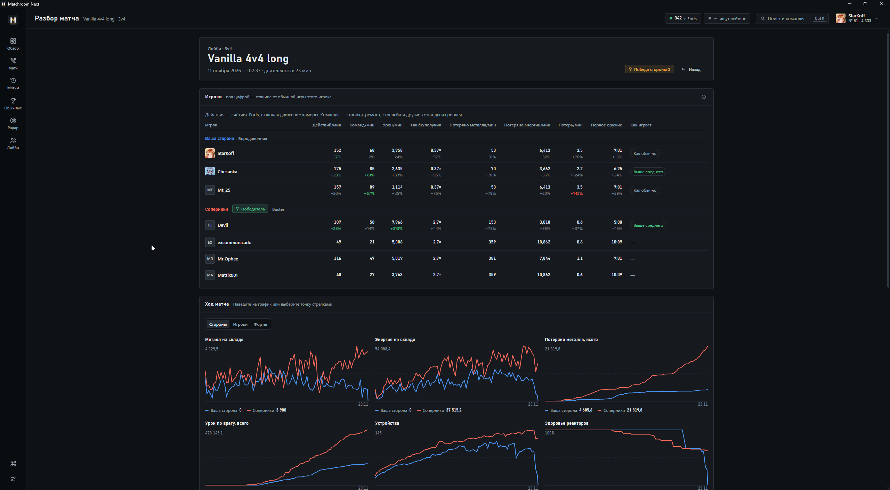
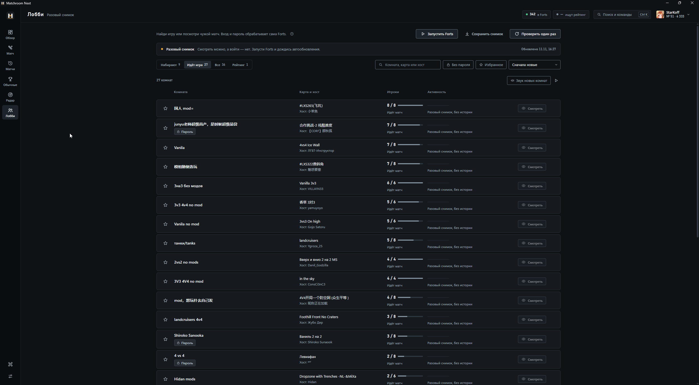

# Matchroom Next

История и статистика матчей Forts для Windows: рейтинг по сезонам, обычные игры,
разбор реплеев, радар игроков и список лобби в отдельном окне.

**[Скачать последнюю версию](https://github.com/DaniilMokhnatkin/MatchroomNext/releases/latest)**

## Возможности

- Обзор сезона: место, очки, график рейтинга, винрейт и серии побед.
- История рейтинговых матчей с результатами, изменением очков, картами и соперниками.
- Статистика обычных игр: режимы, карты, напарники и последние матчи.
- Разбор реплеев: действия и команды в минуту, урон, ресурсы, потери, постройки и графики хода матча.
- Досье игроков с историей встреч и сравнением показателей; сведения о сопернике в рейтинге.
- Радар активности, список лобби, поиск, фильтры и уведомления Windows.

## Запуск

1. Скачай EXE из последнего релиза и положи его в папку с доступом на запись.
2. Запусти программу и проверь папки реплеев в настройках. Новые игры добавляются автоматически.
3. Для актуального рейтинга, радара и входа в лобби запусти Steam и Forts.

Python для готового EXE не нужен. Окно использует WebView2; если его нет,
программа предложит скачать компонент. Данные хранятся в `MatchroomNextData` рядом с EXE.

Обновление: **Настройки → Проверить обновления → Установить и перезапустить**.
При обновлении проверяется SHA-256, папка с данными сохраняется.

Радар показывает косвенные сигналы активности. Отсутствие сигнала не исключает
встречу с игроком; Steam может задерживать или ограничивать обновление данных.

## Скриншоты

Обзор сезона: рейтинг, форма, соперники и карты.

Рейтинговая история и карточка матча.

Обычные игры: статистика по режимам, картам и напарникам.

Разбор реплея: сравнение игроков и графики хода матча.

Лобби: комнаты, карты, заполненность и фильтры.

## Исходники

Клиент — `web/`, сервер — `app_server.py`, оболочка окна — `shell/`.
[Запуск, сборка и проверки](docs/development.md) · [История изменений](CHANGELOG.md).

Основа — Forts Matchroom от Starkoff. Реплеи разбирает
[forts-replay](https://github.com/an0nfunc/forts-replay) (AGPL-3.0,
[лицензия и уведомление](fwr/NOTICE.txt)).
